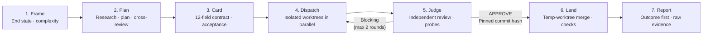

<p align="center">
  
</p>

<h1 align="center">team-lead</h1>

<p align="center">
  <strong>Turn your coordinator agent into a project tech lead orchestrating a multi-model team of Paseo agents.</strong>
</p>

<p align="center">
  <a href="README.md">中文</a> · <strong>English</strong>
</p>

<p align="center">
  
  
  
</p>

---

`team-lead` is an agent skill for **Claude Code** and **Antigravity CLI (`agy`)**. It frames the coordinator session as the project's **Tech Lead**: the user sets goals, direction, and final calls; the lead owns the outcome — bootstrapping per-project dispatch config and docs, planning and cross-reviewing before a single line of code is written, writing task cards with falsifiable acceptance criteria, routing work across model families in isolated git worktrees, judging deliveries with independent read-only verification, and turning every mistake into a permanent check.

> **Core tenet: Quality is set before dispatch.**
> A defect fixed in the plan costs a sentence; the same defect caught in code costs a full fix round.

---

## Contents

- [Why team-lead](#why-team-lead)
- [Core Workflow and Complexity Ladder](#core-workflow-and-complexity-ladder)
- [Multi-Model Routing and Independence](#multi-model-routing-and-independence)
- [Task Cards and Falsifiable Acceptance](#task-cards-and-falsifiable-acceptance)
- [Mistakes Become Checks](#mistakes-become-checks)
- [Project Init and Doc Roles](#project-init-and-doc-roles)
- [Installation and Quick Start](#installation-and-quick-start)
- [Repository Layout](#repository-layout)

---

## Why team-lead

Spawning multiple coding agents ad hoc fails in predictable ways: vague specs lead to runaway rewrites, concurrent writers clobber each other's files, implementers write tautological tests and declare `PASS`, and the same failure mode repeats across tasks.

`team-lead` replaces ad-hoc prompting with four hard engineering constraints:

1. **The lead writes no application code and trusts only raw evidence.** Strong models focus exclusively on judgment — framing, one-way doors, interfaces, card splits, and acceptance criteria. Fast mid-tier models implement and test against written cards; a cheaper standing assistant handles doc upkeep and clerical work.
2. **Plan before code.** Medium and complex work goes through written planning and a read-only **cross-family Plan Review** before any card is dispatched; architectural direction forks run **Dual Planning** in parallel.
3. **Strict isolation and blind, independent review.** One fresh Paseo session and one git worktree per card; one writer per working directory. Reviewers and probe verifiers come from a **different model family**, run in fresh read-only sessions, never see the implementer's self-assessment or `PASS`, and pin every verdict to a single commit hash.
4. **Method separated from project state.** The universal method lives in this skill repo; each project stores only its own `DISPATCH.md` config and `lesson.md` pitfalls — clean, portable, and self-contained.

---

## Core Workflow and Complexity Ladder

<p align="center">
  
  <br />
  <sub><em>Plan &amp; cross-review (amber) → specification cards (ivory) → isolated parallel worktree chambers (cyan) → blind independent review &amp; probe gate (emerald) → verified merge to main</em></sub>
</p>

Every piece of work runs through a **7-step closed loop** (see [`SKILL.md`](SKILL.md)):



### Complexity Ladder

Overhead scales strictly with risk. At the `Frame` step, the highest signal present sets the complexity tier, governing both **upfront planning** and **post-code verification** (see [`references/planning.md`](references/planning.md)):

| Complexity | Signals | Before code | After code |
| :--- | :--- | :--- | :--- |
| **Simple** | Single card on an existing pattern; no new interface or dependency | Write the card | Implementer self-verifies from the final artifact; code review only in `DISPATCH` sensitive areas; docs get no extra check |
| **Medium** | Several cards, or a new interface inside known technology | Write plan → cross-family **Plan Review** | Read-only code review by a strong model |
| **Complex** | Any **one-way door**; unknown platform/library behavior; concurrency, state machines, cross-module contracts; phase gates | Research + fact-check → plan (plus **Dual Planning** on direction forks) → **spike cards** for unknowns land first → Plan Review | **Code review** and **independent probe verification**, dispatched in parallel on the same commit |

> **One-way door**: a decision costly to undo — data models, module boundaries, public interfaces, persistence formats, or a new dependency. Cards with visible UI changes add a visual check by the verifier.

### Design Bar

Every plan, plan review, and task card enforces four rules:

- **Decide one-way doors for the long run now; keep everything else minimal.** No speculative abstractions for imagined future requirements.
- **Lead with a tracer bullet.** The first card builds the thinnest runnable end-to-end path; later cards thicken it rather than re-cutting what already works.
- **Reuse before writing.** Existing project code and dependencies → mature maintained library → proven product pattern → bespoke code last.
- **Delete replaced code.** No compatibility shims, migrations, or fallback paths unless `DISPATCH.md` explicitly records users or data depending on old behavior.

---

## Multi-Model Routing and Independence

<p align="center">
  
  <br />
  <sub><em>Upper tier: Lead (amber octahedron) and independent cross-family reviewer behind a privacy partition (emerald crystal); middle tier: specialized isolated worktree pods (UI, logic, probes, builds); side wing: standing doc assistant</em></sub>
</p>

### Three-Tier Division of Labor

- **Judgment & Review (Strong Models, Cross-Family)**: The Lead owns framing, architecture, interfaces, card splits, and acceptance. A strong model from a **different model family** serves as independent planner (Dual Planning), plan reviewer, and code reviewer.
- **Execution & Verification (Fast Mid-Tier Models)**: Routed by task type (UI, core logic, builds/device diagnostics, fact-checking, independent probing) into isolated worktrees. Cards leave implementers *how* to write the code, never *what* to build or *which* approach to pick.
- **Clerical Support (Standing Assistant)**: Handles doc upkeep, card boilerplate, and verifying minor suggestion fixes, while goals, scope, acceptance, and technical decisions stay with the Lead.

### Rules of Independent Judgment

Defined in [`references/review.md`](references/review.md):

- **Strict independence**: Verifier and reviewer use a **different model family** from the implementer, run in a **fresh read-only session**, and are never shown the implementer's self-assessment or `PASS`.
- **One verdict, one commit**: Review and verification cards name the exact commit hash and the verdict repeats it. Before landing, the branch head must equal the judged commit hash (or every subsequent commit must be verified against review items); otherwise re-review.
- **Blocking vs. Suggestion**: Only issues that hit the project's `DISPATCH` blocking list, violate the card's stated claim/scope, or break an existing test/contract — **with a concrete trigger path** — are `Blocking`. Out-of-scope edge cases are re-graded to carried suggestions in the tracker and never hold up a merge.
- **At most two fix rounds**: Review and probe results on a commit feed a single fix round; blocking items are sent back verbatim (never paraphrased). If blocking items remain after round two, escalate to the user with a recommendation.

### Living Model Temperament Notes

Cross-project empirical notes on real model families and Paseo operational mechanics live in [`references/models.md`](references/models.md) — covering observed strengths, failure modes, card guardrails, `xhigh` vs. `max`/`ultra` thinking levels, `team-lead=<project>` agent labeling, remote host nuances, and `steer` vs. queued delivery. It evolves as models change, keeping project configs clean.

---

## Task Cards and Falsifiable Acceptance

A task card is the **entire contract**: the worker agent sees only the card and its worktree. A card missing any required section is never sent (full spec in [`references/card.md`](references/card.md)).

### Falsifiable Acceptance

> "Tests added" or "suite green" is **evidence**, never **acceptance**.

Every acceptance item is written as a falsifiable scenario:

```text
input or state  →  expected behavior  →  how it is observed (test name / command output / screenshot / hash)
```

- **A wrong implementation must fail at least one item.** Scenarios come directly from the plan's risks: platform semantics, double-firing callbacks, late async results, main-thread delivery, hangs/timeouts, interleavings, and counter-examples of past failures.
- The implementer writes the scenarios as **failing tests first**. On complex cards, the verifier writes its own probes from the card's claims **before reading the implementer's tests**.
- Cards name **concrete functions and components**, not vague intentions (e.g., *"call `buildGroups()` from `x.ts`"* instead of *"reuse the grouping logic"*). Past ~1.5x the estimated line budget, the implementer simplifies before delivering.

### Conclusion-First Delivery Protocol

Because Paseo finish notifications truncate long outputs, every worker's final reply must open verbatim with a status keyword so the lead can act immediately:

| First Word | Meaning | Lead's Next Step |
| :--- | :--- | :--- |
| `DONE` | Whole card delivered and ready to judge | Dispatch independent review / probe verification per complexity |
| `PARTIAL` | Only a slice finished | Return to the **same session** to complete |
| `NEEDS-INPUT` | Unresolved decision or human-only step | Supply the answer or consolidated human checklist |
| `STUCK` | 3 distinct approaches failed on the same item | Revise the plan or card (workers never alter acceptance or skip checks) |

<details>
<summary><strong>Expand: 12-Field Task Card Anatomy (from <code>references/card.md</code>)</strong></summary>

1. `[Role]` One-sentence role definition
2. `[Boundaries]` Repository-only scope, explicit prohibitions, verbatim restricted-machine clause
3. `[Background]` Exact must-read paths (code map first), base branch & commit, prior decisions
4. `[Goal]` One sentence describing the done state
5. `[Scope]` Files/functions/lines to touch, existing helpers/components to call, explicit non-goals
6. `[Steps]` Concrete numbered steps
7. `[Self-check]` Local tests green before pushing; changed tests per step, typecheck/lint/format once at the end
8. `[Acceptance]` Checklist of falsifiable scenarios, each naming its evidence
9. `[Guard the class]` Required on fix cards: what check or structure prevents this class of defect
10. `[Stop conditions]` Stop after 3 failed approaches on the same item; never edit acceptance or skip checks
11. `[Delivery]` Branch & commit convention; conclusion-first reply (`DONE`/`PARTIAL`/`NEEDS-INPUT`/`STUCK`, ~1200 chars cap), full logs in report file
12. `[Cleanup]` Remove only temp files/dirs created by this session

</details>

---

## Mistakes Become Checks

<p align="center">
  
  <br />
  <sub><em>Caught defect (crimson) → feedback loop &amp; forge (amber) → permanent automated guard pin locked into the gate (emerald)</em></sub>
</p>

Every user correction and every rejected review item is closed in the same fix card using a **three-tier ratchet** (see [`references/review.md`](references/review.md#mistakes-become-checks)):

1. **Make it mechanically checkable**: add a guard test, lint rule, or script assertion whose failure message explains how to fix it. Existing violations go into a **shrink-only allowlist**; new code gets zero tolerance.
2. **Else make the wrong form unwritable**: reshape the interface or directory structure so the mistake cannot be expressed.
3. **Else record a lesson**: add a line to the project's `lesson.md` plus one sentence in the delivery explaining why no mechanical check was possible. Once guarded by a check, a lesson shrinks to a single line naming that check (or is deleted if fully enforced).

Every post-dispatch blocking issue also closes its **upstream gap**: *which line of the plan or card should have stopped it?* General gaps update [`card.md`](references/card.md), project-only pitfalls go to `lesson.md`, and model quirks go to [`models.md`](references/models.md). When two models miss the same bug, the card was underspecified — fix the card before switching models.

---

## Project Init and Doc Roles

When starting on a repository without `DISPATCH.md` / `lesson.md`, or when asked to normalize an existing repo for agent teamwork, the Lead runs **Init** ([`references/init.md`](references/init.md) & [`references/docs.md`](references/docs.md)):

- **Ask, never guess**: Reads the codebase, CI, and scripts, then inspects the Paseo fleet (`list_hosts`, `list_providers`, `list_models`, `list_profiles`). Everything neither the repo nor Paseo specifies (concurrency limits, machine privacy clauses, remote-host models, ask-first rules) is gathered into **one consolidated confirmation proposal** with explicit recommendations.
- **New & existing projects**: New projects start from the user's brief (`Entry`, `Spec`, `Development`), treat `Architecture` as the first complex plan, and open with a tracer-bullet card. Existing projects keep existing docs in place, map them to roles, fill only missing gaps, flag doc-vs-code discrepancies as open questions, and verify every build/test command in a fresh worktree before recording it.
- **Restrained escalation**: Once running, the lead only interrupts the user for items on the ask-first list, open decisions that change the outcome after checking all evidence, or human-only steps (physical device, login, password) — finishing all independent work first and asking once with a recommendation and trade-offs.

### 9 Project Doc Roles (Single Source of Truth)

Each fact has one home; everything else links to it. A role becomes its own file only when it has material of its own:

| Role | Holds | Read by | Default path |
| :--- | :--- | :--- | :--- |
| **Entry** | Project overview, doc index, repo-wide rules, task-card rules | Every agent | `AGENTS.md` |
| **Spec** | Users, goals, scope & non-goals, key journeys, product acceptance, open questions | Plan, Plan Review | `docs/SPEC.md` |
| **Architecture** | Code map, module responsibilities, interfaces, data flow, one-way doors & rationale | Plan, card `[Background]` | `docs/ARCHITECTURE.md` |
| **Development** | Setup, **verified** build/test/lint/format commands, release steps | Card `[Self-check]` | `docs/DEVELOPMENT.md` |
| **Design** | Visual, interaction, and copy rules (UI projects only) | UI cards, copy adviser | `docs/DESIGN.md` |
| **Decisions** | User decisions and one-way doors (date, choice, why) | Everyone | `docs/agents/decisions.md` |
| **Tracker** | Active work, blockers + smallest unblock step, deferred items, carried suggestions, recently done (also handoff notes) | Lead at session start | `docs/agents/handoff.md` |
| **Plans** | One plan per medium or complex piece of work | Plan Review, cards | `docs/plans/<slug>.md` |
| **Dispatch / Lesson** | Project dispatch config (overrides skill defaults) & project-only pitfalls | Lead | `docs/agents/DISPATCH.md`<br>`docs/agents/lesson.md` |

---

## Installation and Quick Start

### Prerequisites

- **Coordinator client**: **Claude Code** or **Antigravity CLI (`agy`)**
- **Agent orchestrator**: **Paseo** (connected via MCP or CLI for managing hosts, git worktrees, agents, schedules, and finish notifications)

### Install

Clone this repository and symlink it into your client's skills directory (keeping it as a git checkout makes pulling updates and updating `references/models.md` effortless):

```bash
git clone https://github.com/mailwmj/team-lead.git /path/to/team-lead

# Claude Code
mkdir -p ~/.claude/skills
ln -s /path/to/team-lead ~/.claude/skills/team-lead

# Antigravity CLI (agy)
mkdir -p ~/.gemini/config/skills
ln -s /path/to/team-lead ~/.gemini/config/skills/team-lead
```

### Usage

1. **First run in a project (Init)**
   Open a coordinator session in your repository and invoke `team-lead`:
   > "Use `team-lead` to initialize this project's agent dispatch config and docs."

   The lead inspects the project and your Paseo fleet, presents one consolidated proposal for confirmation, writes `DISPATCH.md`, `lesson.md`, and the `AGENTS.md` addition, fills doc gaps, and verifies build/test commands in a fresh worktree.

2. **Ongoing development & session handoff**
   On every subsequent session start, the lead automatically loads your project's `DISPATCH.md`, `lesson.md`, decision log, handoff tracker, and [`references/models.md`](references/models.md), queries live Paseo agents and schedules across hosts, reconnects to running `team-lead=<project>` workers so finish notifications route properly, and drives your request through the 7-step loop.

---

## Repository Layout

```text
team-lead/
├── README.md                  # Project documentation (Chinese default)
├── README.en.md               # Project documentation (English)
├── SKILL.md                   # Skill entry: lead role, session start, 7-step loop, escalation rules
├── assets/                    # README illustrations
└── references/
    ├── init.md                # Project init workflow & DISPATCH / lesson / AGENTS templates
    ├── docs.md                # 9 project doc roles, maintenance rules, new vs. existing setup
    ├── planning.md            # Complexity ladder, research, plan structure, design bar, plan review & dual planning
    ├── card.md                # 12-field task card template, falsifiable acceptance & delivery protocol
    ├── review.md              # Independent review, blocking vs. suggestion, 2-round cap, landing & mistakes-to-checks
    └── models.md              # Cross-project empirical model temperaments & Paseo dispatch mechanics
```
