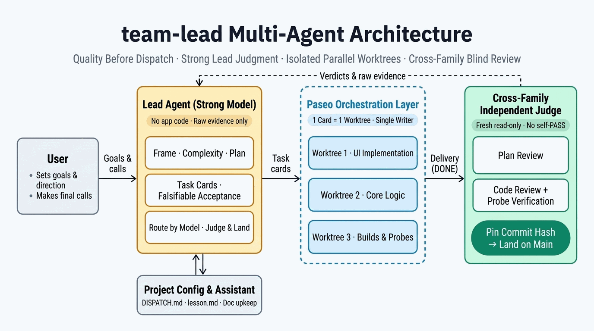
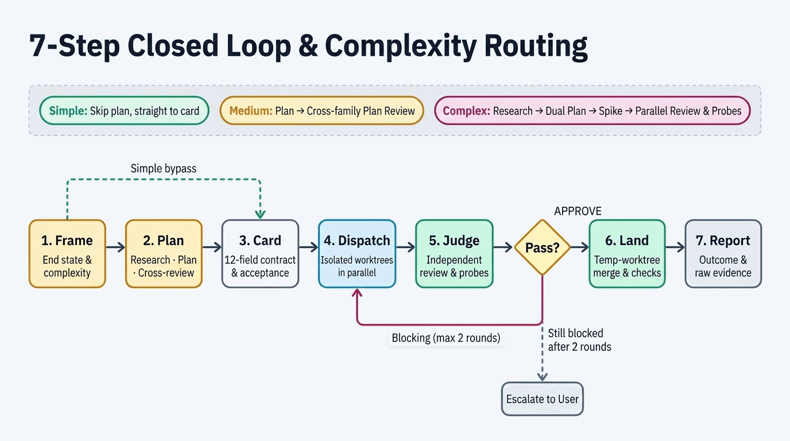
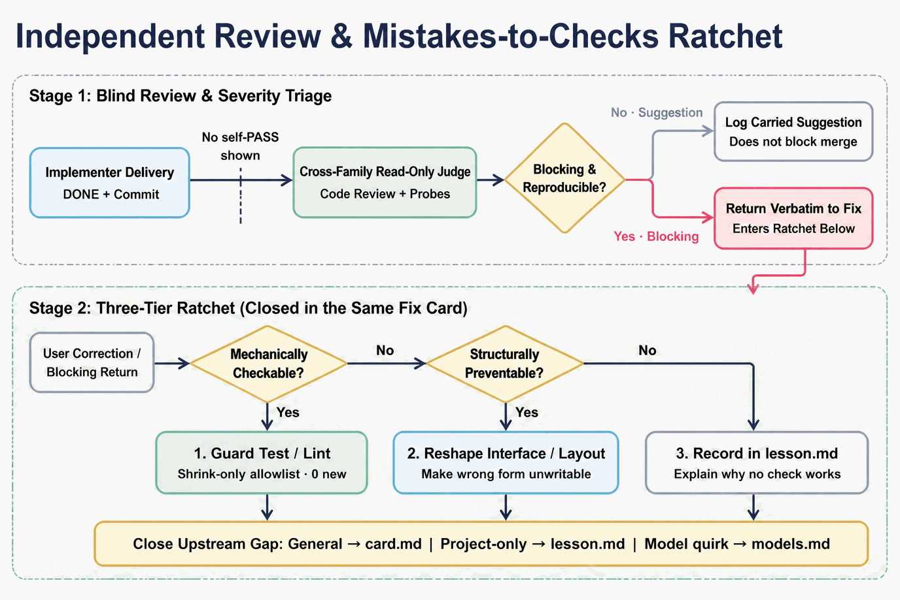

<h1 align="center">team-lead</h1>

<p align="center">
  <strong>An engineering management skill for multi-agent collaboration — turn a coordinator agent into a project Tech Lead orchestrating a multi-model agent team from planning to verified delivery.</strong>
</p>

<p align="center">
  <a href="README.md">中文</a> · <strong>English</strong>
</p>

<p align="center">
  
  
  
  
</p>

<p align="center">
  
</p>

---

`team-lead` is a reusable engineering methodology and `SKILL.md` package built for **multi-agent collaborative development**. Running on top of **Paseo** (multi-host agent and git worktree orchestration), it works with any coordinator harness that supports skills — such as Claude Code, Antigravity CLI (`agy`), and other `SKILL.md`-compatible agents.

It positions the coordinator session as the project's **Tech Lead**: the user sets goals, direction, and final calls; the lead owns delivery — bootstrapping per-project dispatch config and docs, planning and cross-reviewing before a single line of code is written, writing task cards with falsifiable acceptance criteria, routing work across model families in isolated git worktrees, judging outputs via blind independent verification, and turning every mistake into a permanent check.

> **Core tenet: Quality is set before dispatch.**
> A defect fixed in the plan costs a sentence; the same defect caught in code costs a full fix round.

---

## Contents

- [Why team-lead](#why-team-lead)
- [7-Step Closed Loop and Complexity Ladder](#7-step-closed-loop-and-complexity-ladder)
- [Multi-Model Division of Labor](#multi-model-division-of-labor)
- [Task Cards and Falsifiable Acceptance](#task-cards-and-falsifiable-acceptance)
- [Independent Review and Mistakes-to-Checks Ratchet](#independent-review-and-mistakes-to-checks-ratchet)
- [Project Init and Doc Roles](#project-init-and-doc-roles)
- [Installation and Quick Start](#installation-and-quick-start)
- [Repository Layout](#repository-layout)

---

## Why team-lead

Running multiple coding agents ad hoc breaks down in predictable ways: vague specs trigger runaway rewrites, concurrent writers clobber each other's working tree, implementers write tautological tests and declare `PASS`, and the same bug class keeps coming back across tasks.

`team-lead` brings multi-agent collaboration under four hard engineering constraints:

1. **The lead writes no application code and trusts only raw evidence.** Strong models focus exclusively on judgment — framing, one-way doors, interfaces, card splits, and acceptance criteria. Faster execution models implement, build, and probe against written cards; a cheaper standing assistant handles doc upkeep and clerical checks.
2. **Plan before code.** Medium and complex work goes through written planning and a read-only **cross-family Plan Review** before any card is dispatched; architectural direction forks run **Dual Planning** in parallel.
3. **Physical isolation and blind independent review.** One fresh Paseo session and one git worktree per card; strictly one writer per working directory. Reviewers and probe verifiers use a **different model family**, run in fresh read-only sessions, never see the implementer's self-assessment or `PASS`, and pin every verdict to a single commit hash.
4. **Method separated from project state.** The universal collaboration method stays in this skill repo; each project keeps only its own `DISPATCH.md` config and `lesson.md` pitfalls — portable across projects with zero cross-contamination.

---

## 7-Step Closed Loop and Complexity Ladder

<p align="center">
  
</p>

Every piece of work runs through a **7-step closed loop** (`Frame → Plan → Card → Dispatch → Judge → Land → Report`; see [`SKILL.md`](SKILL.md)). Process weight scales automatically with the **complexity tier** rated at `Frame` (see [`references/planning.md`](references/planning.md)):

| Complexity | Signals (highest signal wins) | Before code | After code |
| :--- | :--- | :--- | :--- |
| **Simple** | Single card on an existing pattern; no new interface or dependency | Skip plan, write the card directly | Implementer self-verifies from the final artifact; code review only in `DISPATCH` sensitive areas; docs get no extra check |
| **Medium** | Several cards, or a new interface inside known technology | Write plan → cross-family **Plan Review** | Read-only code review by a strong model |
| **Complex** | Any **one-way door**; unknown platform/library behavior; concurrency, state machines, cross-module contracts; phase gates | Research + fact-check → plan (plus **Dual Planning** on direction forks) → **spike cards** for unknowns land first → Plan Review | **Code review** and **independent probe verification**, dispatched in parallel on the same commit |

> **One-way door**: a choice costly to undo — data models, module boundaries, public interfaces, persistence formats, or a new dependency. Cards with visible UI changes add a visual check by the verifier; non-trivial copy or interaction changes also get post-implementation advice from a copy-strong model.

### Design Bar

Every plan, plan review, and task card enforces four rules:

- **Decide one-way doors for the long run now; keep everything else minimal.** No speculative abstractions for imagined future needs.
- **Lead with a tracer bullet.** The first card builds the thinnest runnable end-to-end path; later cards thicken it rather than re-cutting what already works.
- **Reuse before writing.** Existing project code and dependencies → mature maintained library → proven product pattern → bespoke code last.
- **Delete replaced code.** No compatibility shims, migrations, or fallback paths unless `DISPATCH.md` explicitly records users or data depending on old behavior.

---

## Multi-Model Division of Labor

Effective multi-agent collaboration does not clone one model N times — it routes work across model families and capability tiers, creating structural checks and balances between **decision, implementation, and verification**:

| Tier | Roles | Model Strategy | Core Responsibilities |
| :--- | :--- | :--- | :--- |
| **Decision** | Coordinator **Lead** | Strong model | Goal framing, complexity rating, architecture & one-way doors, card splits, falsifiable acceptance, landing calls |
| **Judgment** | **Plan / Code Reviewer**, Independent Planner | **Cross-family** strong model (read-only) | Plan Review, Dual Planning (blind to lead's draft), blind code review, independent probe verification |
| **Execution** | **Implementer / Verifier / Builder** | Fast mid-tier models | Card-driven UI & core logic in isolated worktrees, builds/device diagnostics, fact-checking |
| **Clerical** | **Standing Assistant** | Low-cost standing session | Doc upkeep, card boilerplate, verifying minor suggestion fixes |

Cross-project empirical notes on real model families (strengths, failure modes, card guardrails) and Paseo operational mechanics (`xhigh` vs. `max`/`ultra`, `team-lead=<project>` labels, `steer` vs. queue, remote host quirks) live in [`references/models.md`](references/models.md) and evolve with real project data.

---

## Task Cards and Falsifiable Acceptance

A task card is the **entire contract**: the worker agent sees only the card and its worktree. A card missing any required field is never dispatched (full spec in [`references/card.md`](references/card.md)).

### Falsifiable Acceptance

> "Tests added" or "suite green" is **evidence**, never **acceptance**.

Every acceptance item is written as a falsifiable scenario:

```text
input or state  →  expected behavior  →  how it is observed (test name / command output / screenshot / hash)
```

- **A wrong implementation must fail at least one item.** Scenarios come directly from the plan's risks: platform semantics, double-firing callbacks, late async results, main-thread delivery, hangs/timeouts, interleavings, and counter-examples of past failures.
- The implementer writes the scenarios as **failing tests first**. On complex cards, the verifier writes its own probes from the card's claims **before reading the implementer's tests**.
- Cards name **concrete functions and components**, not vague intentions (e.g., *"call `buildGroups()` from `x.ts`"* instead of *"reuse the grouping logic"*). Past ~1.5x the estimated line budget, the implementer simplifies before delivering.

### Conclusion-First Delivery Protocol

Because Paseo finish notifications truncate long outputs, every worker's final reply opens verbatim with a status keyword so the lead can act immediately:

| First Word | Meaning | Lead's Next Step |
| :--- | :--- | :--- |
| `DONE` | Whole card delivered and ready to judge | Dispatch independent review / probe verification per complexity |
| `PARTIAL` | Only a slice finished | Return to the **same session** to complete |
| `NEEDS-INPUT` | Unresolved decision or human-only step | Supply the answer or consolidated human checklist |
| `STUCK` | 3 distinct approaches failed on the same item | Revise the plan or card (workers never alter acceptance or skip checks) |

<details>
<summary><strong>Expand: 12-Field Task Card Anatomy (from <code>references/card.md</code>)</strong></summary>

1. `[Role]` One-sentence role definition
2. `[Boundaries]` Repository-only scope, explicit prohibitions, verbatim restricted-machine clause
3. `[Background]` Exact must-read paths (code map first), base branch & commit, prior decisions
4. `[Goal]` One sentence describing the done state
5. `[Scope]` Files/functions/lines to touch, existing helpers/components to call, explicit non-goals
6. `[Steps]` Concrete numbered steps
7. `[Self-check]` Local tests green before pushing; changed tests per step, typecheck/lint/format once at the end
8. `[Acceptance]` Checklist of falsifiable scenarios, each naming its evidence
9. `[Guard the class]` Required on fix cards: what check or structure prevents this class of defect
10. `[Stop conditions]` Stop after 3 failed approaches on the same item; never edit acceptance or skip checks
11. `[Delivery]` Branch & commit convention; conclusion-first reply (`DONE`/`PARTIAL`/`NEEDS-INPUT`/`STUCK`, ~1200 chars cap), full logs in report file
12. `[Cleanup]` Remove only temp files/dirs created by this session

</details>

---

## Independent Review and Mistakes-to-Checks Ratchet

<p align="center">
  
</p>

All review, landing, and ratchet rules are defined in [`references/review.md`](references/review.md):

### Rules of Independent Judgment

- **Strictly blind**: Verifier and reviewer use a **different model family** from the implementer, run in a **fresh read-only session**, and are never shown the implementer's self-assessment or `PASS`.
- **One verdict, one commit**: Review cards name the exact commit hash and verdicts repeat it. Landing merges in a **temporary worktree** off `origin/main` only when branch `HEAD` matches the judged commit hash.
- **Strict triage & two-round cap**: Only issues hitting `DISPATCH` blocking criteria, violating the card's stated claim/scope, or breaking an existing test/contract — **with a concrete trigger path** — are `Blocking`. Everything else is logged as a `Suggestion` in the tracker and never holds up a merge. Review and probe findings on the same commit feed one fix round, forwarded verbatim; if blocking items remain after round two, escalate to the user with a recommendation.

### Three-Tier Ratchet (Mistakes Become Checks)

Every user correction and every rejected review item is closed in the same fix card along a strict priority ladder:

1. **Mechanically checkable → automated guard**: add a guard test, lint rule, or script assertion whose failure message explains how to fix it. Existing violations go into a **shrink-only allowlist**; new code gets zero tolerance.
2. **Else structurally preventable → reshape interface or layout**: make the wrong form impossible to write.
3. **Else record a lesson**: add a line to `lesson.md` plus one sentence in the delivery explaining why no mechanical check was possible. Once guarded by a check, a lesson shrinks to a one-line pointer (or is deleted when fully enforced).

Every post-dispatch blocking item also closes its **upstream gap** in [`card.md`](references/card.md) (general), `lesson.md` (project-only), or [`models.md`](references/models.md) (model temperament). When two models miss the same bug, the card was underspecified — fix the card before switching models.

---

## Project Init and Doc Roles

When starting on a repository without `DISPATCH.md` / `lesson.md`, or normalizing an existing repo for multi-agent teamwork, the Lead runs **Init** ([`references/init.md`](references/init.md) & [`references/docs.md`](references/docs.md)):

- **Ask, never guess**: Reads the repo, scripts, and CI, then queries the Paseo fleet (`list_hosts`, `list_providers`, `list_models`, `list_profiles`). Everything neither the repo nor Paseo specifies (concurrency limits, machine privacy clauses, remote-host models, ask-first rules) is gathered into **one consolidated confirmation proposal** with explicit recommendations.
- **New & existing projects**: New projects generate `Entry`, `Spec`, and `Development` from the user's brief and plan `Architecture` as the first complex piece of work. Existing projects keep existing docs in place, map them to roles, fill only missing gaps, flag doc-vs-code discrepancies as open questions, and verify every build/test command in a fresh worktree before recording it.
- **Restrained escalation**: Once running, the lead only interrupts the user for ask-first items, open decisions that change the outcome after checking evidence, or human-only steps (physical device, login, password) — finishing all independent work first and asking once with recommendations and trade-offs.

### 9 Project Doc Roles (Single Source of Truth)

Each fact has one home; everything else links to it. A role becomes its own file only when it has material of its own:

| Role | Holds | Read by | Default path |
| :--- | :--- | :--- | :--- |
| **Entry** | Project overview, doc index, repo-wide rules, task-card rules | Every agent | `AGENTS.md` |
| **Spec** | Users, goals, scope & non-goals, key journeys, product acceptance, open questions | Plan, Plan Review | `docs/SPEC.md` |
| **Architecture** | Code map, module responsibilities, interfaces, data flow, one-way doors & rationale | Plan, card `[Background]` | `docs/ARCHITECTURE.md` |
| **Development** | Setup, **verified** build/test/lint/format commands, release steps | Card `[Self-check]` | `docs/DEVELOPMENT.md` |
| **Design** | Visual, interaction, and copy rules (UI projects only) | UI cards, copy adviser | `docs/DESIGN.md` |
| **Decisions** | User decisions and one-way doors (date, choice, why) | Everyone | `docs/agents/decisions.md` |
| **Tracker** | Active work, blockers + smallest unblock step, deferred items, carried suggestions, recently done (also handoff notes) | Lead at session start | `docs/agents/handoff.md` |
| **Plans** | One plan per medium or complex piece of work | Plan Review, cards | `docs/plans/<slug>.md` |
| **Dispatch / Lesson** | Project dispatch config (overrides skill defaults) & project-only pitfalls | Lead | `docs/agents/DISPATCH.md`<br>`docs/agents/lesson.md` |

---

## Installation and Quick Start

### Prerequisites

- **Any `SKILL.md`-compatible coordinator agent**: e.g., Claude Code, Antigravity CLI (`agy`), or another agent harness supporting skills
- **Multi-agent orchestration layer**: **Paseo** (connected via MCP or CLI to manage multi-model workers, git worktrees, remote hosts, schedules, and finish notifications)

### Install

Clone this repository and symlink it into your coordinator agent's skills directory (keeping it as a git checkout makes pulling updates and recording cross-project findings in [`references/models.md`](references/models.md) seamless):

```bash
git clone https://github.com/mailwmj/team-lead.git /path/to/team-lead

# Example 1: Claude Code
mkdir -p ~/.claude/skills
ln -s /path/to/team-lead ~/.claude/skills/team-lead

# Example 2: Antigravity CLI (agy)
mkdir -p ~/.gemini/config/skills
ln -s /path/to/team-lead ~/.gemini/config/skills/team-lead

# Other SKILL.md-compatible clients: symlink or copy into your client's skills directory
```

### Usage

1. **First run in a project (Init)**
   Open a coordinator session in your repository and invoke `team-lead`:
   > "Use `team-lead` to initialize this project's multi-agent dispatch config and docs."

   The lead inspects the project and your Paseo fleet, presents one consolidated proposal for confirmation, writes `DISPATCH.md`, `lesson.md`, and the `AGENTS.md` addition, fills doc gaps, and verifies build/test commands in a fresh worktree.

2. **Ongoing development & session handoff**
   On every subsequent session start, the lead automatically loads your project's `DISPATCH.md`, `lesson.md`, decision log, handoff tracker, and [`references/models.md`](references/models.md), queries live Paseo agents and schedules across hosts, reconnects to running `team-lead=<project>` workers so finish notifications route properly, and drives your request through the 7-step loop.

---

## Repository Layout

```text
team-lead/
├── README.md                    # Project documentation (Chinese default)
├── README.en.md                 # Project documentation (English)
├── SKILL.md                     # Skill entry: lead role, session start, 7-step loop, escalation rules
├── assets/                      # Flat-style architecture & workflow diagrams (3 ZH + 3 EN)
└── references/
    ├── init.md                  # Project init workflow & DISPATCH / lesson / AGENTS templates
    ├── docs.md                  # 9 project doc roles, maintenance rules, new vs. existing setup
    ├── planning.md              # Complexity ladder, research, plan structure, design bar, plan review & dual planning
    ├── card.md                  # 12-field task card template, falsifiable acceptance & delivery protocol
    ├── review.md                # Independent review, blocking vs. suggestion, 2-round cap, landing & mistakes-to-checks
    └── models.md                # Cross-project empirical model temperaments & Paseo dispatch mechanics
```
