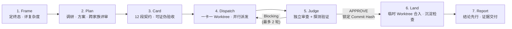

<p align="center">
  
</p>

<h1 align="center">team-lead</h1>

<p align="center">
  <strong>让主控 Agent 以技术负责人（Tech Lead）的身份，统筹一支基于 Paseo 的多模型 Agent 工程团队。</strong>
</p>

<p align="center">
  <strong>中文</strong> · <a href="README.en.md">English</a>
</p>

<p align="center">
  
  
  
</p>

---

`team-lead` 是一套面向 **Claude Code** 与 **Antigravity CLI（`agy`）** 的工程管理 Skill。它把主控会话定位为项目的 **Tech Lead**：用户负责定目标、定方向与最终拍板，Lead 负责交付结果——完成项目派发初始化、编码前的方案设计与跨模型家族评审、编写带可证伪验收条件的任务卡、按模型特质路由并隔离 Worktree 派发、用独立只读会话审查验证，最后把每一次返工沉淀为永久检查。

> **核心信条：质量在派发前锁定（Quality is set before dispatch）。**
> 在方案阶段修掉一个缺陷只需要一句话；同一个缺陷拖到代码阶段，代价是一整轮返工。

---

## 目录

- [为什么需要 team-lead](#为什么需要-team-lead)
- [核心工作流与复杂度阶梯](#核心工作流与复杂度阶梯)
- [多模型分工与独立裁判](#多模型分工与独立裁判)
- [任务卡与可证伪验收](#任务卡与可证伪验收)
- [错误沉淀为检查](#错误沉淀为检查)
- [项目初始化与文档体系](#项目初始化与文档体系)
- [安装与快速开始](#安装与快速开始)
- [仓库结构](#仓库结构)

---

## 为什么需要 team-lead

直接同时开多个 Coding Agent 干活，最常见的失控路径只有几种：需求没收敛就开始写代码、两个 Agent 在同一目录互相覆盖、实现者自测写水测试并宣称 `PASS`、同一个坑在不同任务里反复踩。

`team-lead` 用四条硬约束把多 Agent 协作拉回工程秩序：

1. **Lead 不写业务代码，只对原始证据负责**：强模型把精力全部留在判断上（目标拆解、单向门决策、接口契约、卡片拆分、验收标准）；编码、构建与探测交给更快的执行模型按卡落地；文档维护与小修复核交给常驻助手。
2. **先定方案，再动一行代码**：中大型任务必须先出方案并经**不同模型家族**的强模型做只读 Plan Review；涉及架构或方向分叉时触发双轨规划（Dual Planning），先对齐再拆卡。
3. **严格隔离与独立审查**：一卡一独立 Git Worktree，单工作目录永远只有一个写者；评审者与探测验证者必须是**与实现者不同模型家族**的全新只读会话，绝不看实现者的自评与 `PASS`，结论死锁到具体 Commit Hash。
4. **方法论与项目配置解耦**：通用工程方法留在 Skill 仓库里；每个项目只保存自己的派发配置（`DISPATCH.md`）与项目专属踩坑记录（`lesson.md`），跨项目复用、互不污染。

---

## 核心工作流与复杂度阶梯

<p align="center">
  
  <br />
  <sub><em>方案与双轨评审（琥珀）→ 规格任务卡（象牙）→ 独立隔离 Worktree 并行实现（青色）→ 盲评独立审查与探测验证（翠绿）→ 证据合入主干</em></sub>
</p>

每一项工作都遵循固定的 **7 步闭环**（详见 [`SKILL.md`](SKILL.md)）：



### 复杂度阶梯（Complexity Ladder）

并非所有改动都需要重流程。Lead 在 `Frame` 阶段先按最高命中信号评定复杂度，直接决定**编码前要规划多深**、**编码后要检查多严**（详见 [`references/planning.md`](references/planning.md)）：

| 复杂度 | 判定信号 | 编码前 | 编码后 |
| :--- | :--- | :--- | :--- |
| **Simple** | 单卡、沿用既有模式、无新接口或新依赖 | 直接写任务卡 | 实现者基于最终产物自证；仅在 `DISPATCH` 标记的敏感区域补代码审查；纯文档改动免额外审查 |
| **Medium** | 跨多张卡，或在已知技术栈内引入新接口 | 写方案 → 跨模型家族 **Plan Review** | 强模型只读代码审查 |
| **Complex** | 存在**单向门**决策、未知平台/库行为、并发/状态机/跨模块契约、阶段里程碑 | 先调研 + 事实核查 → 方案（方向分叉时走**双轨规划**）→ 未知点先落地 **Spike 卡** → Plan Review | **代码审查**与**独立探测验证**针对同一 Commit 并行派发 |

> **单向门（One-way door）**：撤销成本极高的选择（数据模型、模块边界、公开接口、持久化格式、新引入依赖）。涉及可见 UI 改动的卡片额外叠加视觉验收。

### 设计基线（Design Bar）

所有方案、方案评审与任务卡共同遵守四条工程基线：

- **单向门面向长期一次定稳，其余一切从简**：不为假想中的未来做过度抽象。
- **第一张卡必须是曳光弹（Tracer Bullet）**：先打通最薄的可运行端到端路径，后续卡片逐步加厚，而不是反复推倒重切。
- **复用优先于手写**：项目现有代码与依赖 → 成熟维护的第三方库 → 成熟产品的验证模式 → 最后才写新代码。
- **替换即删除**：除非 `DISPATCH.md` 明确记录了依赖旧行为的用户或历史数据，否则直接删除被替换代码，不留兼容层或降级兜底。

---

## 多模型分工与独立裁判

<p align="center">
  
  <br />
  <sub><em>上层：主控 Lead（琥珀八面体）与隔墙独立跨家族评审（翠绿晶体）；中层：按专长路由的隔离 Worktree 执行舱（UI / 逻辑 / 探测 / 构建）；侧翼：常驻文档助手</em></sub>
</p>

### 三层能力路由

- **判断与裁判层（强模型，跨模型家族）**：Lead 负责目标定界、方案设计、接口定义与验收条件；由**另一个模型家族**的强模型担任独立规划顾问（Dual Planning）、Plan Reviewer 与 Code Reviewer。
- **实现与验证层（高性价比中层执行模型）**：按任务类型（UI、核心逻辑、构建与设备诊断、只读事实核查、独立探测验证）查表路由，在隔离 Worktree 中按卡执行。卡片已经锁定了"做什么"和"怎么做"，执行者只需专注把代码写好并跑绿。
- **事务助手层（低成本常驻会话）**：负责文档同步、卡片样板整理与小修核对；但目标、范围、验收与架构决策永远留在 Lead 手里。

### 独立审查铁律

详见 [`references/review.md`](references/review.md)：

- **真正的独立**：评审者与验证者必须与实现者来自**不同模型家族**、启动**全新只读会话**，且绝不向其展示实现者的自评说明或 `PASS` 结论。
- **结论绑定单一 Commit**：审查卡和回复结论必须携带具体的 Commit Hash；合入前分支 `HEAD` 必须等于已审 Commit，否则重审。
- **严分 Blocking 与 Suggestion**：只有命中 `DISPATCH` 阻断项、违背卡片声明范围或破坏既有测试/契约，且附带**可复现触发路径**的问题才算 `Blocking`；其余超范围边界建议一律降级记入 Tracker 留待后续顺手处理，不卡合入。
- **最多两轮修复**：同一 Commit 的代码审查与探测验证结果汇总进同一轮修复；阻塞项原文发回实现者（不转述失真）。两轮后仍有阻塞项，直接带建议升级给用户拍板。

### 活的模型习性档案

跨项目积累的模型实战习性与 Paseo 调度避坑记录集中在 [`references/models.md`](references/models.md) 中维护（含各模型家族的优势、易错点、卡片防呆写法，以及远程宿主机、`steer` 与排队、思考等级 `xhigh`、`team-lead=<project>` 标签追踪等实操细节），随真实项目经验持续增删演化，而不写死在项目配置里。

---

## 任务卡与可证伪验收

任务卡是派发给执行 Agent 的**唯一完整契约**——执行者只看得到这张卡和它的 Worktree，缺少任何必填字段的卡都不会发出（完整模板见 [`references/card.md`](references/card.md)）。

### 什么是可证伪验收（Falsifiable Acceptance）

> "已补充测试"或"测试套件全绿"只是**证据**，永远不是**验收标准**。

每一条验收项都必须写成可证伪的场景：

```text
输入 / 初始状态  →  预期行为  →  观测方式（测试名 / 命令输出 / 截图 / 产物哈希）
```

- **错误的实现至少会触发一条验收项失败**；验收场景直接源自方案中的风险点（平台语义、重复回调、异步乱序、主线程投递、超时死锁、历史故障反例）。
- 实现者必须**先写失败测试**再实现；复杂任务的独立验证者在**读实现者测试之前**，先依据卡片声明独立编写探测用例。
- 卡片写**具体函数名与组件名**，而非含糊意图（写"调用 `x.ts` 的 `buildGroups()`"，不写"复用分组逻辑"）；超出预估行数 ~1.5x 需在交付前主动简化。

### 结论前置交付协议

Paseo 的完成通知会自动截断，因此每张卡的最终回复必须以固定状态词开头，确保截断后依然能一眼做决策：

| 首词状态 | 含义 | Lead 的下一步动作 |
| :--- | :--- | :--- |
| `DONE` | 卡片全部完成，可进入裁判 | 按复杂度启动独立审查 / 探测验证 |
| `PARTIAL` | 仅完成部分内容 | 发回**原会话**继续补完 |
| `NEEDS-INPUT` | 遇到未定义决策或人工步骤 | 补充决策或整合人工清单后回复 |
| `STUCK` | 同一项尝试 3 种不同方案仍失败 | 调整方案或改写任务卡（禁止执行者擅改验收或跳过检查） |

<details>
<summary><strong>展开查看：12 段标准任务卡结构（来自 <code>references/card.md</code>）</strong></summary>

1. `[Role]` 一句话角色定位
2. `[Boundaries]` 仓库边界、禁止事项、受限宿主机原文条款
3. `[Background]` 必读文件精确路径（代码地图优先）、基线分支与 Commit、既有决策
4. `[Goal]` 一句话描述完成后的终态
5. `[Scope]` 要改的文件/函数/行范围、须复用的既有函数与组件、明确不做的内容
6. `[Steps]` 编号的具体步骤
7. `[Self-check]` 本地跑绿再推送；每步只跑相关测试，收尾统一跑 typecheck / lint / format
8. `[Acceptance]` 可证伪场景清单，每项指明对应证据
9. `[Guard the class]` 修复卡必填：用何种检查或结构杜绝此类问题重演
10. `[Stop conditions]` 同一项 3 种思路失败即停并上报；严禁修改验收标准或跳过检查
11. `[Delivery]` 分支名与提交规范；首词状态 + 结论前置短回复（~1200 字符内），详细日志写进报告文件
12. `[Cleanup]` 仅清理本会话创建的临时文件与目录

</details>

---

## 错误沉淀为检查

<p align="center">
  
  <br />
  <sub><em>拦截的缺陷（绯红）→ 反馈回路与锻造（琥珀）→ 永久嵌回门禁的自动化检查齿（翠绿），让同类错误无法再次通过</em></sub>
</p>

每一次人工纠正和每一条被评审打回的阻断项，都必须在修复它的同一张卡里按**三级棘轮**闭环（详见 [`references/review.md`](references/review.md#mistakes-become-checks)）：

1. **优先变成机械检查**：能用 guard test、lint 规则或脚本断言拦截的，立刻写成自动化检查，且报错信息直接写明修复方式。存量违规放进**只缩不增**的 allowlist，新增代码零容忍。
2. **其次变成结构防呆**：无法机械检查但能通过接口或目录改造让错误写法根本写不出来的，直接改结构。
3. **最后才写进教训**：两者皆不可行时，才在项目 `lesson.md` 记一行教训，并在交付中用一句话说明为何无法自动化检查。已被检查护住的教训收缩为一行指向该检查的索引，完全护住则直接删除。

同时向**上游追问**：*方案或卡片的哪一行本应拦住这个问题？*——通用漏洞补进 [`card.md`](references/card.md)，项目专属漏洞补进 `lesson.md`，模型习性记入 [`models.md`](references/models.md)。如果两个模型漏掉同一个问题，说明是卡片写得不够清楚，先改卡再考虑换模型。

---

## 项目初始化与文档体系

首次在项目中启用 `team-lead`，或需要把存量项目整理成适合 Agent 协作的结构时，Lead 会自动进入 **Init 流程**（[`references/init.md`](references/init.md) 与 [`references/docs.md`](references/docs.md)）：

- **只问不猜（Ask, never guess）**：先通读仓库代码/构建脚本/CI，再通过 Paseo 查询当前宿主机、Provider 与可用模型；凡是仓库与 Paseo 没写明的信息（并发上限、受限机器隐私条款、远程宿主机可用模型等），全部汇成**一次结构化确认清单**附带推荐值让用户拍板。
- **新老项目通吃**：新项目根据用户简报生成入口/规格/开发文档，把架构作为第一项 Complex 任务来规划；存量项目保留原有文档路径与名称，只映射角色、补齐缺口，代码与文档冲突处标为待决问题，并派执行模型在干净 Worktree 里把所有构建/测试命令实际跑通后再写入文档。
- **克制打扰**：初始化之后，Lead 只在三类情况询问用户——命中 `DISPATCH` 必问清单、查遍证据仍开放且影响结果的决策、或必须由人操作的物理/登录步骤。先把不依赖答案的工作做完，再把选项、推荐与后果一次问清。

### 项目 9 类文档角色（单一事实来源）

每个事实只在一个地方维护，其他位置全部用链接指向它；仅当该角色有独立内容时才单独成文：

| 角色 | 承载内容 | 主要读者 | 默认路径 |
| :--- | :--- | :--- | :--- |
| **Entry** | 项目概览、文档索引、所有 Agent 必守规则、任务卡说明 | 所有 Agent | `AGENTS.md` |
| **Spec** | 用户、目标、范围与非目标、核心旅程、产品级验收、待决问题 | 方案、Plan Review | `docs/SPEC.md` |
| **Architecture** | 代码地图、模块职责、接口契约、数据流、单向门及原因 | 方案、任务卡 `[Background]` | `docs/ARCHITECTURE.md` |
| **Development** | 环境配置、**已实测通过**的构建/测试/检查命令、发布步骤 | 任务卡 `[Self-check]` | `docs/DEVELOPMENT.md` |
| **Design** | 视觉、交互与文案规范（仅含 UI 的项目） | UI 卡片、文案顾问 | `docs/DESIGN.md` |
| **Decisions** | 用户拍板与单向门记录（日期、选择、原因） | 所有人 | `docs/agents/decisions.md` |
| **Tracker** | 进行中、阻塞与最小解阻步、延期项、延续建议、近期完成（兼交接笔记） | Lead 开场时 | `docs/agents/handoff.md` |
| **Plans** | 每个 Medium / Complex 任务一份完整方案 | Plan Review、卡片 | `docs/plans/<slug>.md` |
| **Dispatch / Lesson** | 项目专属派发规则（优先级高于 Skill 默认值）与项目踩坑记录 | Lead | `docs/agents/DISPATCH.md`<br>`docs/agents/lesson.md` |

---

## 安装与快速开始

### 前置依赖

- **主控客户端**：**Claude Code** 或 **Antigravity CLI（`agy`）**
- **Agent 调度层**：已接入 MCP 工具或 CLI 的 **Paseo**（用于管理多宿主机、Git Worktree、子 Agent 生命周期与完成通知）

### 安装

克隆本仓库，并软链到对应客户端的 skills 目录（建议保留仓库以便随时 `git pull` 更新或回写 `references/models.md`）：

```bash
git clone https://github.com/mailwmj/team-lead.git /path/to/team-lead

# Claude Code
mkdir -p ~/.claude/skills
ln -s /path/to/team-lead ~/.claude/skills/team-lead

# Antigravity CLI (agy)
mkdir -p ~/.gemini/config/skills
ln -s /path/to/team-lead ~/.gemini/config/skills/team-lead
```

### 使用方式

1. **首次进入项目（初始化）**
   在你的项目目录启动主控会话，直接说明使用 `team-lead` 接管或初始化项目：
   > “用 `team-lead` 初始化这个项目的 Agent 协作配置与文档。”

   Lead 会自动扫描项目与 Paseo 舰队，给出一次汇总确认单；等你确认后写入 `DISPATCH.md`、`lesson.md`、`AGENTS.md` 等文件并实测验证构建与测试命令。

2. **日常迭代与跨会话接管**
   以后每次开启或恢复统筹会话时，Lead 会自动读取项目的 `DISPATCH.md`、`lesson.md`、决策日志与交接笔记，结合 [`references/models.md`](references/models.md)，并调用 Paseo 的 `list_agents` / `list_schedules` 认领所有带 `team-lead=<project>` 标签的运行中 Agent，确保完成通知无缝衔接，然后按 7 步闭环推进你的目标。

---

## 仓库结构

```text
team-lead/
├── README.md                  # 项目说明（中文默认）
├── README.en.md               # Project documentation (English)
├── SKILL.md                   # Skill 入口：Lead 定位、开场检查、7 步闭环、提问边界
├── assets/                    # README 配图
└── references/
    ├── init.md                # 项目初始化步骤与 DISPATCH / lesson / AGENTS 模板
    ├── docs.md                # 9 类项目文档角色、维护规则与新老项目初始化路径
    ├── planning.md            # 复杂度阶梯、前期调研、方案结构、设计基线、方案评审与双轨规划
    ├── card.md                # 12 段任务卡模板、可证伪验收规范与结论前置交付协议
    ├── review.md              # 独立审查规则、Blocking 界定、两轮修复、安全合入与错误沉淀为检查
    └── models.md              # 跨项目模型实战习性观察与 Paseo 调度机制备忘
```
