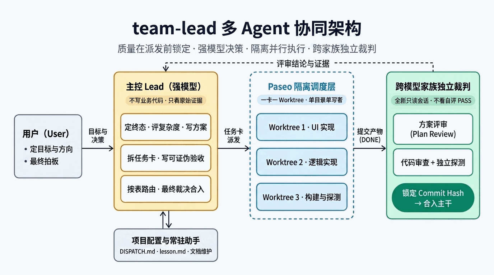
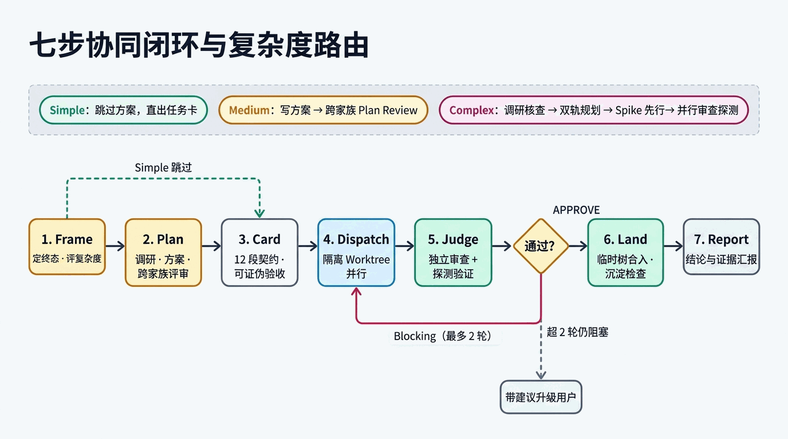
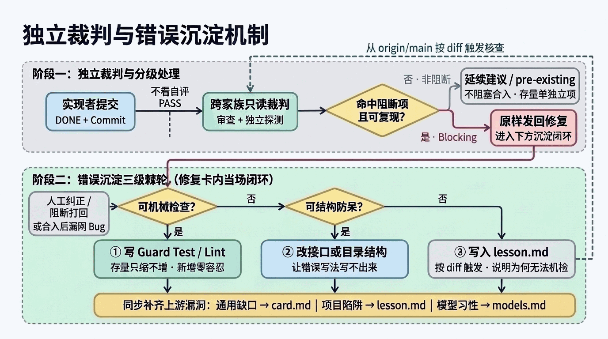

<h1 align="center">team-lead</h1>

<p align="center">
  <strong>面向多 Agent 协同研发的工程管理 Skill——让主控 Agent 以技术负责人（Tech Lead）的身份，统筹多模型 Agent 团队完成端到端交付。</strong>
</p>

<p align="center">
  <strong>中文</strong> · <a href="README.en.md">English</a>
</p>

<p align="center">
  
  
  
  
</p>

<p align="center">
  
</p>

---

`team-lead` 是一套面向**多 Agent 协同**的工程方法论与可复用 Skill 包（基于 **Paseo** 多 Agent / Worktree 调度层，支持任何兼容 `SKILL.md` 的主控 Agent，例如 Claude Code、Antigravity CLI `agy` 等）。

它将主控会话定位为项目的 **Tech Lead**：用户负责定目标、定方向与最终拍板，Lead 负责交付结果——完成项目协作初始化、编码前的方案设计与跨模型家族评审、编写带可证伪验收条件的任务卡、按模型专长路由并隔离 Worktree 并行派发、组织独立只读会话审查验证，并把每一次返工沉淀为永久检查。

> **核心信条：质量在派发前锁定（Quality is set before dispatch）。**
> 在方案阶段修掉一个缺陷只需要一句话；同一个缺陷拖到代码阶段，代价是一整轮返工。

---

## 目录

- [为什么需要 team-lead](#为什么需要-team-lead)
- [七步协同闭环与复杂度阶梯](#七步协同闭环与复杂度阶梯)
- [多模型角色分工](#多模型角色分工)
- [任务卡与可证伪验收](#任务卡与可证伪验收)
- [独立裁判与错误沉淀机制](#独立裁判与错误沉淀机制)
- [项目初始化与文档体系](#项目初始化与文档体系)
- [安装与快速开始](#安装与快速开始)
- [仓库结构](#仓库结构)

---

## 为什么需要 team-lead

直接同时开多个 Coding Agent 协同干活，失控几乎总沿着同一条路径发生：需求还没收敛就开始写代码、并发写者在同一目录互相覆盖、实现者写水测试并自称 `PASS`、同一个坑在不同任务里反复踩。

`team-lead` 用四条工程硬约束把多 Agent 协同拉回可控状态：

1. **Lead 不写业务代码，只对原始证据负责**：强模型把全部精力留在判断上（目标定界、单向门决策、接口契约、卡片拆分、验收标准）；实现、构建与探测交给更快的执行模型按卡落地；文档维护与小修复核交给低成本常驻助手。
2. **先定方案，再动一行代码**：中大型任务必须先出书面方案并经**不同模型家族**的强模型做只读 Plan Review；遇到架构或方向分叉时触发双轨规划（Dual Planning），先对齐再拆卡。
3. **物理隔离与盲评裁判**：一卡一独立 Git Worktree，单工作目录永远只有一个写者，并行运行同时隔离端口、测试库与设备（无法隔离则按配置串行）；评审者与探测验证者必须是**与实现者不同模型家族**的全新只读会话，绝不看实现者的自评与 `PASS`，结论死锁到单一 Commit Hash。
4. **方法论与项目配置解耦**：通用协同规范留在 Skill 仓库；每个项目只维护自己的派发配置（`DISPATCH.md`）和项目专属踩坑记录（`lesson.md`），跨项目复用、互不污染。

---

## 七步协同闭环与复杂度阶梯

<p align="center">
  
</p>

每一项工作都遵循固定的 **7 步闭环**（`Frame → Plan → Card → Dispatch → Judge → Land → Report`，详见 [`SKILL.md`](SKILL.md)）。流程轻重由 `Frame` 阶段评定的**复杂度**自动控制，不搞一刀切（详见 [`references/planning.md`](references/planning.md)）：

| 复杂度 | 判定信号（命中最高项生效） | 编码前 | 编码后 |
| :--- | :--- | :--- | :--- |
| **Simple** | 单卡、沿用既有模式、无新接口或新依赖 | 跳过方案，直接写任务卡 | 实现者基于最终产物自证；仅在 `DISPATCH` 标记的敏感区域补代码审查；纯文档改动免额外审查 |
| **Medium** | 跨多张卡，或在已知技术栈内引入新接口 | 写方案 → 跨模型家族 **Plan Review** | 强模型只读代码审查 |
| **Complex** | 存在**单向门**决策、未知平台/库行为、并发/状态机/跨模块契约、多张卡共享的运行时状态（滚动、焦点、导航）、手势与帧时序、阶段里程碑 | 调研 + 事实核查 → 方案（方向分叉走**双轨规划**）→ 未知点先落地 **Spike 卡** → Plan Review | **代码审查**与**独立探测验证**针对同一 Commit 并行派发 |

> **单向门（One-way door）**：撤销成本极高的选择（数据模型、模块边界、公开接口、持久化格式、新引入依赖）。涉及可见 UI 改动的卡片由审查者看截图，只有 Complex 卡才由验证者另做视觉验收；涉及用户可见文案或交互流时，实现后可送交文案专长模型给建议。
>
> **调度与防降级纪律**：派发按**依赖图**而非里程碑推进（有空槽即可启动前置接口已定的卡片，里程碑只是汇报点）；会话若陷入反复试错（上下文腐化）或卡在无超时命令上，归档旧会话并拆小或收紧卡片以新会话重派，不往腐化上下文硬发 `continue`。改动曾通过独立探测的代码无论体量大小，复杂度均不低于原验证卡，且严禁为省时跳过任意应做检查。多张卡共写同一运行时状态（滚动/焦点/导航）时只定**单一拥有者**，后合入卡须与先合入卡合并后再探测。

### 设计基线（Design Bar）

方案、方案评审与任务卡共同遵守四条工程基线：

- **单向门面向长期一次定稳，其余一切从简**：不为假想中的未来需求做提前抽象。
- **第一张卡必须是曳光弹（Tracer Bullet）**：先打通最薄的可运行端到端路径，并同步交付驱动它的可运行 `verify` 命令；后续卡片逐步加厚。
- **复用优先于手写**：项目现有代码与依赖 → 成熟维护的第三方库 → 成熟产品的验证模式 → 最后才写新代码。
- **替换即删除**：除非 `DISPATCH.md` 明确记录了依赖旧行为的用户或历史数据，否则直接删除被替换代码，不留兼容层或降级兜底。

---

## 多模型角色分工

多 Agent 协同不是把同一模型复制 N 份，而是按模型家族差异与能力梯队分工，并在**决策、实现、验证**之间建立结构性制衡：

| 协同层级 | 承担角色 | 模型策略 | 核心职责 |
| :--- | :--- | :--- | :--- |
| **决策层** | 主控 **Lead** | 强模型 | 目标拆解、复杂度评定、方案与单向门决策、拆卡、写可证伪验收、合入裁决 |
| **裁判层** | **Plan / Code Reviewer**、独立规划顾问 | **跨模型家族**强模型（只读） | 方案评审、双轨规划（不看 Lead 草稿）、盲评代码审查与独立探测验证 |
| **执行层** | **Implementer / Verifier / Builder** | 高性价比中层执行模型 | 在隔离 Worktree 中按任务卡实现 UI / 逻辑、运行构建与设备诊断、事实核查 |
| **事务层** | **Standing Assistant** | 低成本常驻会话 | 文档同步更新、卡片样板整理、小额建议修复与无审卡越界检查改动核对 |

跨项目沉淀的各模型家族实战习性（优势、典型失误模式、卡片防呆条款）及 Paseo 多宿主机调度细则（如思考等级 `xhigh`、`team-lead=<project>` 标签追踪、`steer` 实时插队、远程宿主机交互等）统一维护在 [`references/models.md`](references/models.md) 中，随真实协同经验持续更新。

---

## 任务卡与可证伪验收

任务卡是派发给执行 Agent 的**唯一完整契约**——执行者只看得到这张卡与它的 Worktree，缺任一必填字段的卡都不会发出（共享同一数据源、UI 模式与验收方法的界面归为一张卡；完整规范见 [`references/card.md`](references/card.md)）。独立审查与探测卡则使用精简的 **6 段固定模板** + 不超过 10 行的单卡焦点（见 [`references/review.md`](references/review.md)）。

### 可证伪验收（Falsifiable Acceptance）

> “已补充测试”或“测试套件全绿”只是**证据**，永远不是**验收标准**。

每条验收项必须写成可证伪的场景：

```text
输入 / 初始状态  →  预期行为  →  观测方式（测试名 / 命令输出 / 截图 / 产物哈希）
```

- **错误实现至少会触发一条验收项失败**；场景直接来自方案风险（平台语义、回调重入、异步乱序、主线程投递、超时死锁、历史故障反例）。涉及不变量/编解码/状态机/优化优先用**属性测试**，重写/迁移在同卡内用旧实现做**差分测试**后再删除旧代码。
- 实现者必须**先写失败测试**再编码；有可运行行为改动时须通过项目的 `verify` 命令实跑一次并采集所见（含 UI 截图）；复杂任务的独立验证者在**阅读实现者测试之前**，先依据卡片声明独立编写探测用例。
- 卡片必须写**具体函数名与组件名**，而非含糊意图（如写“调用 `x.ts` 的 `buildGroups()`”，不写“复用分组逻辑”）；超出预估行数 ~1.5x 需在交付前主动简化。

### 结论前置交付协议

Paseo 的完成通知会自动截断，因此每张卡的最终回复必须以固定状态词开头，让主控一眼决定下一步：

| 首词状态 | 含义 | Lead 的下一步动作 |
| :--- | :--- | :--- |
| `DONE` | 卡片全部完成，可进入裁判 | 按复杂度启动独立审查 / 探测验证 |
| `PARTIAL` | 仅完成部分内容 | 发回**原会话**继续补完 |
| `NEEDS-INPUT` | 遇到未定义决策、未授权既有检查失败或人工步骤 | 补充决策、处置存量 flaky 或整合一次性人工清单后回复 |
| `STUCK` | 同一项尝试 3 种不同方案仍失败 | 调整方案或改写任务卡（禁止执行者擅改验收、跳过检查或靠 sleep/重跑掩盖失败） |

<details>
<summary><strong>展开查看：12 段标准任务卡结构（来自 <code>references/card.md</code>）</strong></summary>

1. `[Role]` 一句话角色定位
2. `[Boundaries]` 仓库边界、禁止事项、受限宿主机原文条款
3. `[Background]` 必读文件精确路径（代码地图优先）、基线分支与 Commit、既有决策、已知 flaky 列表
4. `[Goal]` 一句话描述完成后的终态
5. `[Scope]` 要改的文件/函数/行范围、须复用的既有函数与组件、授权变更的既有检查清单、明确不做的内容
6. `[Steps]` 编号的具体步骤
7. `[Self-check]` 本地跑绿再推送；每步只跑相关测试，收尾跑 typecheck / lint / format，有可运行行为改动时经 `verify` 命令实跑一次并留证（全量套件留给 CI）
8. `[Acceptance]` 可证伪场景清单，每项指明对应证据
9. `[Guard the class]` 修复卡必填：用何种检查或结构杜绝此类问题重演
10. `[Stop conditions]` 同一项 3 种思路失败即停；严禁修改验收标准、跳过检查或用 sleep / 放大超时 / 重跑碰绿掩盖失败；清单外无关失败先提交再报 `NEEDS-INPUT`
11. `[Delivery]` 分支名与提交规范；首词状态 + 结论前置短回复（~1200 字符内），详细日志写进报告文件
12. `[Cleanup]` 停止本会话启动的后台进程，并仅清理本会话创建的临时文件与目录

</details>

---

## 独立裁判与错误沉淀机制

<p align="center">
  
</p>

完整的评审、合入与沉淀规则定义在 [`references/review.md`](references/review.md)：

### 独立裁判铁律

- **彻底盲评与基线规则隔离**：审查者与探测验证者与实现者来自**不同模型家族**、运行在**全新只读会话**，使用固定的 6 段审查/探测模板（+ ≤10 行单卡焦点），绝不向其提供实现者的自评或 `PASS` 结论；审查时从 `origin/main` 读取 `lesson.md` 并核查触发条件命中本次 diff 的条目，同时对照 `[Scope]` 授权清单核查既有检查是否被范围外放松。
- **一票定一版与验证戳**：审查卡指定具体 Commit Hash，结论必须复述该 Hash；合入在 `origin/main` 拉出的**临时 Worktree** 中完成，分支 `HEAD` 必须与已审 Hash 一致；共写同一运行时状态的后合入卡须与先合入卡合并后再探测；无审查卡若在清单外改动门禁配置或删除既有测试行先由常驻助手核查；合入提交附 `Verified:` 验证戳（含 `self`）便于事后追溯。
- **严格分级与两轮收敛**：只有命中 `DISPATCH` 阻断清单、违反卡片声明范围（含范围外放松既有检查）或破坏既有测试/契约，且附带**具体触发路径**的问题才定级为 `Blocking`；其余降级为 `Suggestion` 记入延续建议（在 `origin/main` 复现的存量缺陷标 `pre-existing`，于 tracker 单独立项），均不阻塞合入。同一 Commit 的审查与探测结果合并进同一轮修复，阻塞项原文发回；第二轮发回原审查者（仅当探测者提出、改动其已测代码或重写时同步回探测者），聚焦第一轮阻断项与增量 diff 及其调用方；超过两轮仍有阻塞项，带建议升级给用户拍板。

### 错误沉淀三级棘轮（Mistakes Become Checks）

每一次人工纠正与每一条被打回的阻断项，都必须在修复它的同一张卡里按优先级闭环：

1. **可机械检查 → 写自动化门禁**：增加 guard test、lint 规则或脚本断言，报错信息直接指出修复方式。存量违规放进**只缩不增**的 allowlist，新增代码零容忍。
2. **不可机检但可结构防呆 → 改造接口或目录结构**：让错误写法在结构上根本写不出来。
3. **两者皆不可行 → 记入 `lesson.md`**：仅收录能从 diff 识别触发信号的同类风险（`触发信号 → 检查项`），并在交付中用一句话说明为何无法自动化检查。追加时先合并同类；已被检查护住的教训收缩为一行索引，完全护住则直接删除。

同时对派发后阻断项及**合入后漏网 Bug** 向上游追问“方案、卡片或验证链的哪一环本应拦住这个问题”，将漏洞回写到 [`card.md`](references/card.md)、项目 `lesson.md` 或 [`models.md`](references/models.md)（追加前先压缩为结论与数据点数）。两个不同模型漏掉同一个问题时，说明卡片本身未写清，先修卡片再换模型。

---

## 项目初始化与文档体系

首次在项目中启用 `team-lead`，或需要将存量仓库规范化以适配多 Agent 协同时，Lead 自动进入 **Init 流程**（[`references/init.md`](references/init.md) 与 [`references/docs.md`](references/docs.md)）：

- **只问不猜（Ask, never guess）**：先通读仓库代码、构建脚本与 CI，再查询 Paseo 舰队（宿主机、Provider、可用模型与 Profile）；凡是仓库和 Paseo 未写明的约束（并发上限、并行端口/测试库隔离策略、受限机器隐私条款、远程宿主机模型、必问清单等），汇总成**一次确认单**附带推荐值由用户确认。
- **新老项目通吃**：新项目根据简报生成入口/规格/开发文档，把架构作为第一项 Complex 任务规划；存量项目保留原有文档路径与名称，仅做角色映射与补缺，代码与文档冲突处标为待决问题，并派模型在干净 Worktree 实测构建/测试命令（`verify` 冒烟命令连跑两次确认稳定）通过后再写入文档。
- **克制打扰**：日常运行中只在命中 `DISPATCH` 必问清单、查遍证据仍开放的重大决策、或仅人能执行的物理/登录步骤时提问；先完成所有独立工作，再带推荐方案与后果一次问清。

### 项目 9 类文档角色（单一事实来源）

每项事实只在一个位置维护，其余处以链接引用；只有具备独立内容的角色才单独建文件：

| 角色 | 承载内容 | 主要读者 | 默认路径 |
| :--- | :--- | :--- | :--- |
| **Entry** | 项目概览、文档索引、仓库通用规则、任务卡说明 | 所有 Agent | `AGENTS.md` |
| **Spec** | 用户、目标、范围与非目标、核心旅程、产品级验收、待决问题 | 方案、Plan Review | `docs/SPEC.md` |
| **Architecture** | 代码地图、模块职责、接口契约、数据流、单向门及原因 | 方案、任务卡 `[Background]` | `docs/ARCHITECTURE.md` |
| **Development** | 环境配置（含单 Worktree 端口/测试库/设备隔离）、**实测通过**的构建/测试/检查命令、驱动真实入口的 `verify` 命令、发布步骤 | 任务卡 `[Self-check]` | `docs/DEVELOPMENT.md` |
| **Design** | 视觉、交互与文案规范（仅含 UI 的项目） | UI 卡片、文案顾问 | `docs/DESIGN.md` |
| **Decisions** | 用户拍板与单向门记录（日期、选择、原因） | 所有人 | `docs/agents/decisions.md` |
| **Tracker** | 进行中、阻塞与最小解阻步、延期项、延续建议、近期完成（兼交接笔记） | Lead 开场时 | `docs/agents/handoff.md` |
| **Plans** | 每个 Medium / Complex 任务一份完整方案 | Plan Review、卡片 | `docs/plans/<slug>.md` |
| **Dispatch / Lesson** | 项目派发规则（优先级高于 Skill 默认值）与 diff 触发式风险教训 | Lead（`lesson` 同时供审查者从 `origin/main` 读取） | `docs/agents/DISPATCH.md`<br>`docs/agents/lesson.md` |

---

## 安装与快速开始

### 前置条件

- **支持 `SKILL.md` 的主控 Agent 客户端**：任意支持 Skill 机制的 Coding Agent 均可作为主控 Lead（例如 Claude Code、Antigravity CLI `agy` 等）
- **多 Agent 调度层**：已接入 MCP 工具或 CLI 的 **Paseo**（用于统一调度跨宿主机、多模型家族的子 Agent、Git Worktree、定时任务与完成通知）

### 安装

克隆本仓库，并软链到你所使用的主控 Agent 的 skills 目录（保留 git 仓库便于随时 `git pull` 更新及沉淀 [`references/models.md`](references/models.md)）：

```bash
git clone https://github.com/mailwmj/team-lead.git /path/to/team-lead

# 示例 1：Claude Code
mkdir -p ~/.claude/skills
ln -s /path/to/team-lead ~/.claude/skills/team-lead

# 示例 2：Antigravity CLI (agy)
mkdir -p ~/.gemini/config/skills
ln -s /path/to/team-lead ~/.gemini/config/skills/team-lead

# 其他支持 SKILL.md 的客户端：软链或复制到对应的 skills 目录即可
```

### 上手流程

1. **首次进入项目（初始化）**
   在项目根目录启动主控会话并触发 `team-lead`：
   > “用 `team-lead` 初始化这个项目的多 Agent 协同配置与文档。”

   Lead 会自动扫描项目与 Paseo 舰队，给出一次汇总确认单；确认后生成 `DISPATCH.md`、`lesson.md`、补充 `AGENTS.md` 并实测验证所有构建与测试命令。

2. **日常研发与跨会话接管**
   每次新开或恢复主控会话时，Lead 自动加载项目的 `DISPATCH.md`、`lesson.md`、决策日志与交接笔记，结合 [`references/models.md`](references/models.md)，并通过 Paseo 的 `list_agents` / `list_schedules` 认领全部带 `team-lead=<project>` 标签的运行中子 Agent，无缝接管完成通知并按七步闭环推进任务。

---

## 仓库结构

```text
team-lead/
├── README.md                    # 项目说明（中文默认）
├── README.en.md                 # Project documentation (English)
├── SKILL.md                     # Skill 入口：Lead 定位、开场检查、7 步闭环、提问边界
├── assets/                      # 扁平风格架构图与流程图（中英文各 3 张）
└── references/
    ├── init.md                  # 项目初始化步骤与 DISPATCH / lesson / AGENTS 模板
    ├── docs.md                  # 9 类项目文档角色、维护规则与新老项目初始化路径
    ├── planning.md              # 复杂度阶梯、前期调研、方案结构、设计基线、方案评审与双轨规划
    ├── card.md                  # 12 段任务卡模板、可证伪验收规范与结论前置交付协议
    ├── review.md                # 固定审查/探测模板、独立裁判、两轮收敛、带戳合入与错误沉淀棘轮
    └── models.md                # 跨项目模型实战习性观察与 Paseo 调度机制备忘
```
